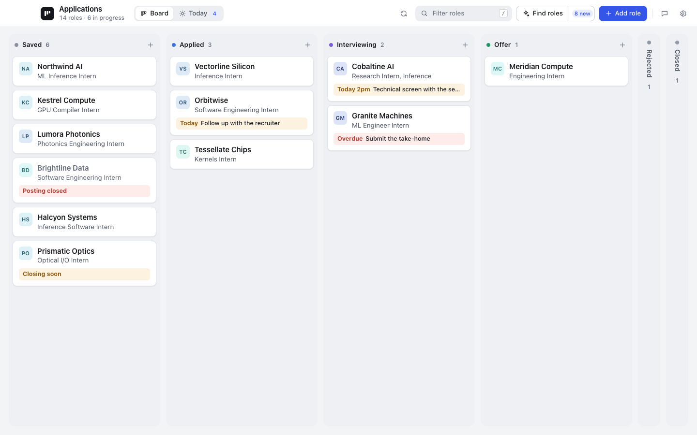
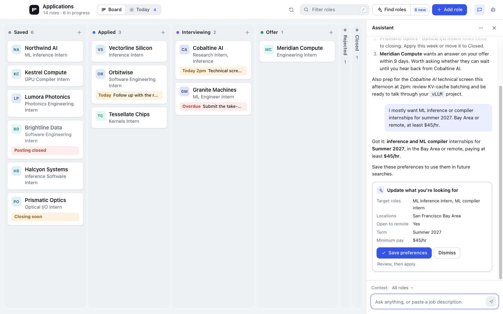

# Internship Tracker

[](https://github.com/chaotyc/internship-tracker/actions/workflows/ci.yml)
[](https://github.com/chaotyc/internship-tracker/releases/latest)
[](LICENSE)

A local-first desktop app for tracking internship and job applications. Move roles across a board from **Saved** to **Offer**, see what's due today, turn recruiter emails into next steps, find new roles that fit you, and fill in applications from your profile, all without an account or a cloud copy of your data.



## Download

Get the latest installer from [Releases](https://github.com/chaotyc/internship-tracker/releases/latest):

| System | File |
| --- | --- |
| macOS (Apple Silicon) | `Internship-Tracker-<version>-mac-arm64.dmg` |
| macOS (Intel) | `Internship-Tracker-<version>-mac-x64.dmg` |
| Windows 10/11 | `Internship-Tracker-<version>-win-x64.exe` |
| Linux | `Internship-Tracker-<version>-linux-x86_64.AppImage` |

The builds aren't signed with a paid developer certificate yet, so your system will ask before the first launch:

- **macOS:** open the app once, then go to **System Settings → Privacy & Security** and click **Open Anyway**.
- **Windows:** on the SmartScreen prompt, click **More info → Run anyway**.
- **Linux:** make the AppImage executable (`chmod +x Internship-Tracker-*.AppImage`) and run it.

## Features

| | |
| --- | --- |
| **Board** | Saved, Applied, Interviewing and Offer, plus Rejected and Closed lanes. Drag cards between stages, or use <kbd>Shift</kbd>+<kbd>←</kbd>/<kbd>→</kbd>. Import any CSV with Company and Role columns. |
| **Today** | Every role can have a dated next step. Today lists what's overdue, due today, this week and later, next to posting deadlines, with done and snooze on each row. |
| **Email updates** | Paste an email, drop a `.eml` file, or connect an inbox read-only over IMAP (Gmail, iCloud, Fastmail or any IMAP server). Emails from companies on your board become proposed updates; nothing changes until you apply them. Unmatched mail never leaves your computer. |
| **Application tracks** | A resume, target roles and saved answers per kind of role (say, ML inference vs photonics hardware). Each role picks a track, and autofill, ranking and the assistant use it. |
| **Add from a link** | Paste a posting link and the app fills in company, role, location, pay and deadline. |
| **Find roles** | Checks the public job boards of companies you choose (Greenhouse, Ashby, Lever and Workday), and optionally the community SimplifyJobs list, then ranks new postings against each of your tracks. An optional daily scan runs while the app is open. |
| **Recheck postings** | Flags saved roles whose postings have closed or are about to. |
| **Assistant** | A chat sidebar that knows your resume, tracks, preferences and board. It can add roles, set next steps, update what you're looking for and draft answers, always as a proposal you confirm. |
| **Autofill** | Opens a Greenhouse, Ashby or Lever application in its own window and fills it from your profile and the role's track. It never submits; you review and click Submit yourself. |
| **Private profile** | Contact details, education, work authorization and optional demographic answers, encrypted with your system keychain. |

<table>
  <tr>
    <td></td>
    <td></td>
  </tr>
</table>

## AI connections

AI features use a model you already have access to. Pick one in **Settings → AI connections**:

- **Your subscription, through its command-line tool:** [Claude Code](https://docs.anthropic.com/en/docs/claude-code), [Codex](https://github.com/openai/codex) or [Gemini CLI](https://github.com/google-gemini/gemini-cli). If one is installed and signed in, the app uses it automatically.
- **An API key** for Anthropic, OpenAI or Google Gemini, stored encrypted in your system keychain.

The app works without one: Find roles ranks by keyword match, and email updates are worked out from simple rules. The assistant needs an AI connection.

## Privacy

- Your data lives in one folder on your computer (`~/Library/Application Support/Internship Tracker` on macOS, `%APPDATA%\Internship Tracker` on Windows, `~/.config/Internship Tracker` on Linux). There's no account, server or telemetry.
- Your profile, saved answers, demographic answers and API keys are encrypted with the system keychain before they're written to disk.
- When you use an AI feature, the relevant parts of your profile, resume and the posting go to the AI provider you connected, and nowhere else.
- Find roles and Recheck postings read public job-board pages. If you connect an inbox, the app signs in read-only to fetch recent mail and matches it against your board on your computer first.
- **Settings → Data & privacy** exports everything to one JSON file or erases it all.

## Build from source

Requires Node.js 22 or later.

```bash
npm install
npm run dev                  # run the app with hot reload
TRACKER_DEMO=1 npm run dev   # with a sample board in a throwaway database
npm run check                # type check and unit tests
npm run dist                 # installers for your system, in ./release
```

See [ARCHITECTURE.md](ARCHITECTURE.md) for how the code is organised and [CONTRIBUTING.md](CONTRIBUTING.md) before opening a pull request.

## License

[MIT](LICENSE)
