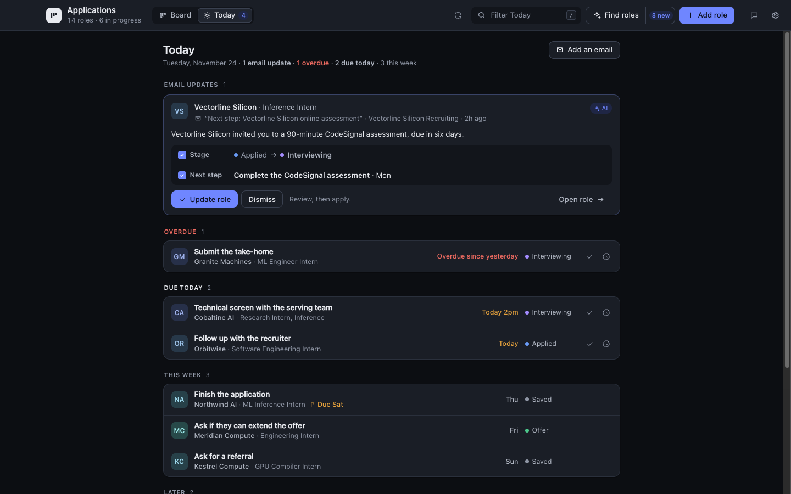

# Internship Tracker

[](https://github.com/chaotyc/internship-tracker/actions/workflows/ci.yml)
[](https://github.com/chaotyc/internship-tracker/releases)
[](LICENSE)

A desktop app for anyone applying to internships or jobs who has lost track of what's due where. It keeps every role on one board, shows what needs doing today, turns recruiter emails into next steps, finds new postings that fit you and fills in applications from your profile. It's local-first: your applications, profile and resume stay on your computer, with no account, server or telemetry.


## Download

Get the installer for your system from the [Releases page](https://github.com/chaotyc/internship-tracker/releases/latest). What changed in each version is in the [changelog](CHANGELOG.md).

| System | File |
| --- | --- |
| macOS (Apple Silicon) | `Internship-Tracker-<version>-mac-arm64.dmg` |
| macOS (Intel) | `Internship-Tracker-<version>-mac-x64.dmg` |
| Windows 10 and 11 | `Internship-Tracker-<version>-win-x64.exe` |
| Linux (Debian, Ubuntu) | `Internship-Tracker-<version>-linux-amd64.deb` |
| Linux (other) | `Internship-Tracker-<version>-linux-x86_64.AppImage` |

The macOS app is also attached as a `.zip` for each chip, if you'd rather not use the disk image.

### Opening it the first time

The builds aren't signed with a paid developer certificate yet, so your system asks before the first launch:

- **macOS:** drag the app to **Applications** and open it. macOS says it can't verify the app; close that message. Then go to **System Settings → Privacy & Security**, scroll to the message about Internship Tracker, click **Open Anyway** and confirm. You only do this once. If macOS instead says the app "is damaged", run `xattr -dr com.apple.quarantine "/Applications/Internship Tracker.app"` in Terminal and open it again.
- **Windows:** on the "Windows protected your PC" prompt, click **More info**, then **Run anyway**.
- **Linux:** install the `.deb` with `sudo apt install ./Internship-Tracker-*.deb`, or make the AppImage executable with `chmod +x Internship-Tracker-*.AppImage` and run it. On Ubuntu 24.04 and later, use the `.deb` (see [FAQ](#the-appimage-wont-start-on-ubuntu-2404-or-later)).

## Getting started

The first time you open the app, a short welcome tour helps you set it up. Every step is optional: click **Skip tour** or press <kbd>Esc</kbd> at any time, and it won't open by itself again. To see it again, open **Settings** and choose **Show welcome tour**.

1. **Connect an AI provider (optional).** Use a Claude Code, Codex or Gemini CLI you're already signed in to, or paste an API key. The tour links to each provider's key page and checks the connection before using it. See [AI connections](#ai-connections).
2. **Add your profile and resume.** They're used to fill in applications and to judge how well a role fits you.
3. **Add your first roles.** Paste a posting link, start from a CSV, or choose companies to watch for **Find roles**.
4. **Take the quick tour** of the Board, Today, Find roles, the assistant and autofill.

After that, open **Today** each day to see what's due.

## Features

| Feature | What it does |
| --- | --- |
| **Board** | Saved, Applied, Interviewing and Offer, plus collapsible Rejected and Closed lanes. Each card shows the company and role, and at most one line when something needs attention: a next step that's overdue or due today, a posting that has closed or is closing, or a deadline within 3 days. Click a card for location, pay, fit, notes and later steps. Drag cards between stages, or use <kbd>Shift</kbd>+<kbd>←</kbd>/<kbd>→</kbd>. Start from a CSV with Company and Role columns. |
| **Today** | Every role can have a dated next step. Today lists what's overdue, due today, this week and later, alongside posting deadlines, with done and snooze on each row. |
| **Email updates** | Paste an email, drop a `.eml` file, or connect an inbox read-only over IMAP (Gmail, iCloud, Fastmail or any IMAP server). Emails from companies on your board become proposed updates, and nothing changes until you apply them. |
| **Application tracks** | A resume, target roles and saved answers for each kind of role you apply to (say, ML inference and photonics hardware). Each role uses a track, and autofill, ranking and the assistant follow it. |
| **Add from a link** | Paste a posting link and the app fills in company, role, location, pay and deadline where the posting lists them. With AI connected, it also rates your fit. |
| **Find roles** | Checks the public job boards of companies you choose (Greenhouse, Ashby, Lever and Workday), and optionally the community SimplifyJobs lists, for internships, new grad roles or any full-time role. It skips postings in other places or terms, ones that mention words you rule out, and ones limited to a higher degree than yours (say, PhD-only roles for an undergraduate), then ranks the rest against each of your tracks. **View skipped** shows everything it left out and why, and you can add any of them. An optional daily scan runs while the app is open. |
| **Recheck postings** | Flags saved roles whose postings have closed or are about to. |
| **Assistant** | A chat sidebar that knows your resume, tracks, preferences and board. It can add and move roles, set next steps, update what you're looking for and save answers, always as a proposal you confirm. |
| **Autofill** | Opens a Greenhouse, Ashby or Lever application in its own window and fills it from your profile and the role's track. It never submits: you review and click Submit yourself. |
| **Private profile** | Contact details, education, work authorization and optional demographic answers, encrypted with your system keychain. |

<table>
  <tr>
    <td></td>
    <td></td>
  </tr>
</table>

## AI connections

AI features use a model you already have access to. Set one up in **Settings → AI connections**:

- **A subscription you already have, through its command-line tool:** [Claude Code](https://code.claude.com/docs), [Codex](https://github.com/openai/codex) or [Gemini CLI](https://github.com/google-gemini/gemini-cli). If one is installed and signed in, the app uses it automatically.
- **An API key** for [Anthropic](https://platform.claude.com/settings/keys), [OpenAI](https://platform.openai.com/api-keys) or [Google Gemini](https://aistudio.google.com/apikey), stored encrypted with your system keychain.

Without one, most of the app still works: Find roles ranks by keyword match, email updates are worked out from simple rules, Add from a link fills in what the posting lists, and autofill works as usual. The assistant needs an AI connection.

## Privacy

- **Your data stays on your computer**, in one folder: `~/Library/Application Support/Internship Tracker` on macOS, `%APPDATA%\Internship Tracker` on Windows and `~/.config/Internship Tracker` on Linux. There's no account, server or telemetry.
- Your profile, saved answers, demographic answers, API keys and inbox password are encrypted with the system keychain before they're written to disk. Your board, notes and the copy of your resume are stored unencrypted in the same folder; turn on your system's disk encryption (FileVault, BitLocker or LUKS) to protect them.
- When you use an AI feature, the relevant parts of your profile, resume, board and the posting go to the AI provider you connected, and nowhere else. Emails that don't match a role on your board are never sent to it.
- Find roles, Recheck postings and Add from a link read public job-board and posting pages, and Find roles reads the SimplifyJobs lists on GitHub if you turn them on. If you connect an inbox, the app signs in read-only, checks message headers against your board, and downloads only the messages that match.
- **Settings → Data & privacy** exports everything except API keys and the inbox password to one JSON file, or deletes everything. The export isn't encrypted and includes your profile and saved answers, so keep it somewhere safe.
- Uninstalling the app leaves the data folder in place. To remove everything, delete that folder after uninstalling.

To report a security problem, see [SECURITY.md](SECURITY.md).

## FAQ

#### Do I need an AI subscription?

No. The board, Today, email updates, Find roles, Add from a link and autofill all work without one. Connecting AI improves ranking and email updates and adds a fit rating to roles you add from a link. Only the assistant requires it. If you already have a Claude, ChatGPT or Gemini plan, signing in through the matching command-line tool lets the app use it instead of an API key.

#### Does it apply for me?

No. Autofill fills in the form and stops; you check it and click Submit yourself. The assistant and email updates only propose changes, and nothing happens until you confirm.

#### On Linux, the app says encryption is off

Encryption uses your desktop's keyring (GNOME Keyring or KWallet). Without one, the app still works, but it says encryption is off and won't store saved answers, demographic answers, API keys or an inbox password. Install and unlock a keyring, then restart the app.

#### The AppImage won't start on Ubuntu 24.04 or later

Ubuntu 24.04 restricts the sandbox that Electron apps use, and the AppImage can't set it up. Install the `.deb` instead; it includes the permission the sandbox needs.

## Build from source

Requires Node.js 22 or later.

```bash
npm install
npm run dev                  # run the app with hot reload, using your real data folder
TRACKER_DEMO=1 npm run dev   # with a sample board in a throwaway database
npm run check                # type check and unit tests
npm run dist                 # installers for your system, in ./release
npm run dist:dir && npm run smoke   # package, then open each view off-screen and check it renders
```

See [ARCHITECTURE.md](ARCHITECTURE.md) for how the code is organised and [CONTRIBUTING.md](CONTRIBUTING.md) before opening a pull request.

## License

[MIT](LICENSE)
